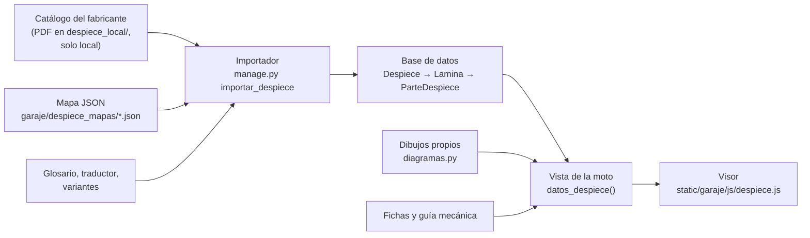

# Despiece interactivo

El despiece muestra cada sistema de la moto (frenos, transmisión, motor…) como un dibujo técnico propio de TallerYa. Cada pieza lleva su número, su nombre en español, una guía de mantenimiento y su estado según el plan de la moto ("Al día", "Pronto", "Toca ya").

Los catálogos de partes de los fabricantes solo se usan en local para leer la lista de piezas. **Nunca se publican**: lo que ve el usuario son los dibujos de `garaje/diagramas.py`.

**Cobertura (nov-2026): 25 líneas con despiece y 26 catálogos.** Los mapas están en `garaje/despiece_mapas/`. Hay un catálogo más que líneas porque la **Suzuki Gixxer 150** tiene dos versiones:
- **`suzuki_gixxer150_fi_abs_2020`**: Gixxer SF con inyección y ABS, de 2020. Es la activa.
- **`suzuki_gixxer150_gsx150l6`**: Gixxer de carburador de 2015, con freno de tambor atrás, del catálogo de Suzuki India. Está cargada pero inactiva.

Cuando una línea tiene varios catálogos, `Despiece.para(moto)` (en `garaje/models.py`) elige, entre los **activos**, el del año de la moto o el anterior más cercano. Un catálogo inactivo no se muestra hasta activarlo en el admin. La más reciente es la **Yamaha Aerox 155**: scooter de 155 cc con CVT, refrigeración líquida, ABS adelante y tambor atrás. Se agregó al catálogo con la migración `garaje/0022_linea_aerox_155` y su mapa es `yamaha_aerox155_bvt2.json`: 23 láminas con dibujos propios, sacadas del catálogo Yamaha Colombia BVT2 2026, que se guarda solo en local.

## Flujo



### 1. Catálogo (solo local)

- Es el PDF de partes del fabricante o del ensamblador, guardado en `despiece_local/` o `manual_despiece/<moto>/`. Ninguna de las dos carpetas va al repositorio.
- Cuando no hay PDF, se usa una carpeta con `fichas.json`: diagramas bajados de tiendas en línea, formato `fichas`.
- Formatos que se leen:

| Formato | Marcas | Lector |
| --- | --- | --- |
| `yamaha` (por defecto) | Yamaha | `importar_despiece.py` |
| `auteco` | Bajaj, KTM, TVS | `importar_despiece.py` |
| `akt`, `honda`, `hero`, `suzuki`, `fichas` | AKT, Honda, Hero, Suzuki, catálogos sin PDF | `garaje/despiece_lectores.py` |

### 2. Mapa JSON

Cada moto tiene un mapa en `garaje/despiece_mapas/` que dice qué figuras del catálogo importar y cómo interpretarlas. Hoy hay 25 mapas con 402 láminas.

```json
{
  "marca": "Yamaha", "linea": "NMAX", "version": "BBE4", "anio": 2024,
  "formato": "yamaha", "fuente": "https://…",
  "laminas": [
    {"figura": 22, "titulo_es": "Freno delantero", "pieza": "freno_del",
     "diagrama": "freno_disco", "reglas": {"BRAKE PAD": "pastillas-del"}}
  ]
}
```

| Clave | Qué es |
| --- | --- |
| `marca`, `linea`, `version`, `anio` | Identifican la moto. La línea debe existir en el catálogo de `LineaMoto`. |
| `formato` | Qué lector usar (tabla de arriba). |
| `carpeta` | Solo en el formato `fichas`. |
| `fuente` | De dónde salió el catálogo. |
| `laminas[].figura` | Número de figura en el catálogo. Puede llevar letra (`"12A"`), pero en la base se guarda solo el número. |
| `laminas[].titulo_es` | Título que ve el usuario. |
| `laminas[].pieza` | Sistema del plan de mantenimiento al que pertenece la lámina (`TareaMantenimiento.Pieza`). |
| `laminas[].diagrama` | Clave del dibujo propio de `diagramas.py` que reemplaza al plano del fabricante. |
| `laminas[].reglas` | Descripción del catálogo → tarea del plan de mantenimiento. Enlaza la pieza con su estado ("Toca ya"…). |

### 3. Importador

Necesita PyMuPDF, que viene en `requirements-dev.txt`.

```bash
python manage.py importar_despiece despiece_local/N-MAX-BBE4-2024.pdf garaje/despiece_mapas/yamaha_nmax_bbe4.json
```

- Por cada figura del mapa guarda la lámina y su tabla de partes (ref., código, descripción, cantidad), y enlaza con el plan las partes que cumplen las `reglas`.
- `garaje/despiece_glosario.py` da a cada pieza un nombre en español que un motociclista reconozca, más una explicación corta. Cuando el glosario no conoce la descripción, `despiece_traductor.py` la traduce palabra por palabra.
- `despiece_variantes.py` distingue piezas que el catálogo llama igual pero tienen distinto código. Por ejemplo, "Abrazadera · del conducto filtro aire".
- `--reemplazar` borra y vuelve a crear las láminas (se pierden las marcas hechas a mano). `--reenlazar` actualiza título, pieza, diagrama y enlaces de las láminas que ya existen, sin borrarlas.
- Después de mejorar el glosario, `python manage.py traducir_despiece` recalcula nombres y explicaciones sin volver a importar.

Modelos (`garaje/models.py`):

- `Despiece`: una versión de catálogo de una línea, por ejemplo NMAX BBE4 2024.
- `Lamina`: una figura del catálogo, con `pieza`, `diagrama`, imagen y orden.
- `ParteDespiece`: una pieza de la lámina, con `ref`, `codigo`, `descripcion`, `nombre_es`, `ayuda`, `cantidad`, `nivel`, enlace opcional a una tarea del plan y posición `x`, `y`.

### 4. Dibujos propios

`garaje/diagramas.py` dibuja cada sistema en isométrico, estilo manual técnico, con sólidos 3D sencillos "explotados" a lo largo de su eje de montaje. Son dibujos por tipo de sistema y sirven para cualquier marca.

- Cada pieza del dibujo tiene un **puesto**. `puesto_para(clave, descripcion)` asigna las partes del catálogo a los puestos por palabras clave, sin marcar a mano.
- La tornillería (tornillos, tuercas, arandelas) va en una franja aparte, al pie del dibujo.
- Hay dos rutas que sirven los SVG: `garaje/diagrama/<clave>.svg` para el dibujo completo y `garaje/diagrama/<clave>/<puesto>.svg` para una pieza sola. La función `version(clave)` da una huella del dibujo para el caché del navegador.

Además, cada pieza muestra textos de dos módulos:

- `despiece_fichas.py`: qué hace, cada cuánto revisarla, señales de falla, consejos y dificultad.
- `despiece_guia_mecanica.py`: la explicación según el papel de la pieza en el sistema, con clave `"diagrama:puesto"` o solo `"puesto"`.

### 5. Visor

- En la página de la moto (`garaje/<pk>/`), `datos_despiece()` en `garaje/views.py` arma las láminas con sus piezas, la posición de cada número (`_posiciones_en_diagrama`) y el estado de mantenimiento de cada pieza. Todo va como JSON en `#datos-despiece`.
- `garaje/static/garaje/js/despiece.js` muestra:
  - los sistemas de la moto;
  - el plano con zoom;
  - las piezas coloreadas por estado, con búsqueda;
  - la ficha de la pieza elegida.
- **Filtro de aire según su tipo.** Los cuidados cambian por tipo, porque el consejo de uno daña a los otros:
  - **seco** (papel): no se lava ni se aceita;
  - **viscoso**: no se limpia ni se sopla, se cambia cuando lo pide el plan;
  - **espuma**: se lava y se aceita.
  
  El tipo sale de la descripción de la pieza (espuma), o de `_FILTRO_AIRE_POR_LINEA` en `garaje/views.py`, o en su defecto de la marca: Yamaha y Honda viscoso, el resto seco.
- **Intervalos:** los textos de cada cuánto vienen de `garaje/intervalos/` (ver *Plan de mantenimiento por moto* en `docs/funciones.md`), no de las fichas.

### 6. Caché

- El despiece armado de cada moto se guarda en la caché `"despiece"`. Fuera de las pruebas es una tabla de la base de datos (`cache_despiece`, hasta 100 entradas), así que sobrevive a los reinicios. Los dibujos SVG van aparte, en la caché `"despiece_svg"`.
- `manage.py precalentar_despiece` arma la caché de todas las motos. Se salta lo que ya está al día, y con `--max-segundos` para a tiempo y dice cuántos faltan.
- Después de cada `push` a `main`, `.github/workflows/despiece.yml` llama a `POST /tareas/despiece/` (con el token `TAREAS_TOKEN`) en tandas de unos 15 s, hasta que no falte ninguno. También se puede lanzar a mano (`workflow_dispatch`).
- La tabla de la caché la crea `build.sh` en cada despliegue (`createcachetable`), y el comando la vuelve a crear si falta.

## Llevar una moto nueva al despiece

1. Conseguir el catálogo y guardarlo en `despiece_local/` (nunca en el repositorio).
2. Crear `garaje/despiece_mapas/<marca>_<linea>_<version>.json` con las figuras que interesan, su `diagrama` y sus `reglas`.
3. Correr `importar_despiece` y revisar la moto en el visor.
4. Si alguna pieza sale con un nombre raro, mejorar el glosario o las variantes y correr `traducir_despiece`.
5. Si una figura no tiene dibujo propio, agregar uno en `diagramas.py`.

## Pendiente para producción

Las láminas se importan en local y quedan en `db.sqlite3` y `media/`. Todavía no hay un mecanismo decidido para llevar esos datos a la base de Render. Las opciones son un fixture exportado sin imágenes del fabricante, o correr el importador contra la base de producción.
