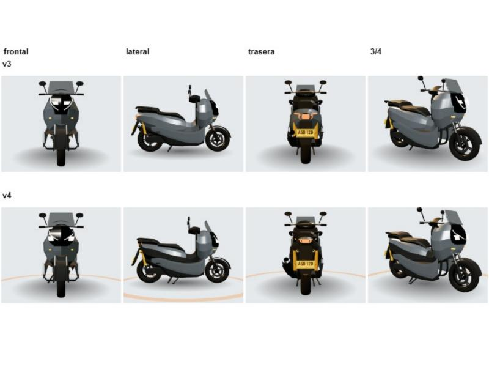
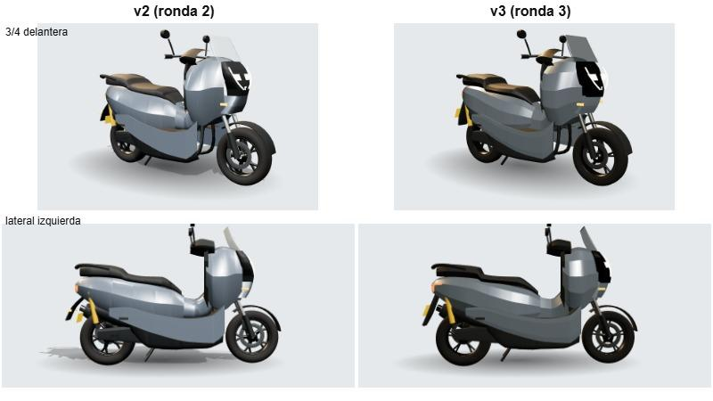
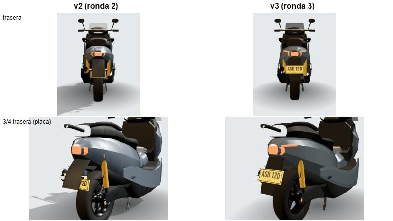
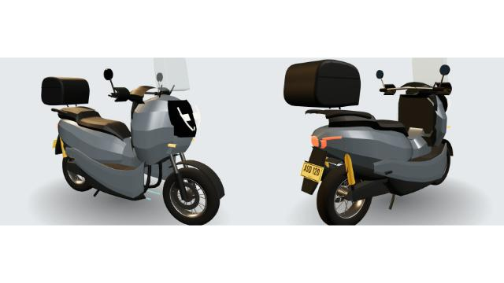

# Skill «moto-3d-realista»: piloto con la Yamaha NMAX 155

## Ronda 4 (18-nov-2026): control estricto y skill más rápida

**Estado:** la NMAX v4 está en `?modelo3d=glb`. No hay commit.

- **Un control más estricto que el IoU de silueta.** La skill ahora mide 12 rasgos en centímetros contra marcas en las fotos y exige que cada uno calce a ≤ 3 cm en **dos vistas ortogonales**. También mide bordes internos.
- **Con ese control aparecieron errores que la silueta no veía.** El faro estaba 8 cm alto y hacia adentro, la cola era 7 cm larga y baja, el escape 11 cm largo y metido, y el escalón del asiento quedaba 2–3 cm alto. Además, los dos tonos estaban mal: en la moto real, abajo del filo del costado y el túnel son plástico negro.
- **Encontré un fallo de la v3:** el protector de escape «panel» nunca había entrado al GLB. El script cambiaba una copia de la pieza, no la de la ficha.

Resultado de la v4 frente a la v3, medido con las mismas marcas y el mismo código:

| Control | v3 | v4 |
|---|---|---|
| Rasgos cumplidos (≤ 3 cm en ≥ 2 vistas ortogonales) | 6/12 | **12/12** |
| IoU de silueta (6 vistas, torno) | 0,886 | **0,888** (0,876–0,902) |
| Bordes internos: precisión / cobertura | 0,42 / 0,72 | 0,44 / 0,75 |
| Duplicados y sobrantes (8 combinaciones de Personalizar) | ok | ok |
| Placa: holgura con el portaplaca / distancia a la llanta | 3 mm / 13 cm | 3 mm / 13 cm |
| GLB | 389 KB, 54 piezas | 400 KB, 55 piezas |

Las dos comparaciones son renders propios, sin fotos de terceros:
- `skill-moto-3d/comparacion-v3-vs-v4-visor.jpg`: captura del visor, gris medio, sin accesorios. En la v4 se ven:
  - el costado negro abajo del filo;
  - la cola más corta y alta, con el stop arriba;
  - el escape más corto y por fuera;
  - los faros más abajo y en las esquinas.

  El aro claro del piso en la fila de la v4 es el resalte de la vitrina del visor; no es parte del modelo.
- `skill-moto-3d/comparacion-v3-vs-v4-render.jpg`: la misma comparación con el render propio, en 6 cámaras fijas. Incluye la vista desde arriba, que no tiene foto de referencia.

### Qué se agregó a la skill

| Pieza | Qué hace |
|---|---|
| `revisar.py` | Renderiza el GLB con la cámara del IoU y compara contra cada foto. **Rasgos**: puntos calculados de la geometría (centro del faro, punta del escape…) frente a las marcas de `rasgos.json`, con el error en cm y hacia dónde mover. **Bordes internos**: líneas del modelo (filos y juntas entre piezas) frente a los bordes de la foto. Hace la hoja foto \| render \| líneas. La lateral se calibra con los ejes, que se conocen exactos por la distancia entre ejes. |
| `ciclo.py` | Una iteración en un comando, en 33 s: generar, IoU, revisión y comparación. Aprueba solo si el IoU pasa y están todos los rasgos. |
| `comparar.py` | Hoja de versiones sin navegador, en 6 cámaras fijas (con la de arriba), en ~20 s. |
| `capturas_visor.js` | Capturas del visor con cámaras fijas y el panel vN \| vN+1, en dos llamadas. |
| `preparar_vistas.py` | Juego de fotos por vista en un comando: baja los cuadros del 360°, arma las carpetas con foto y máscara y escribe `vistas.json`. |
| `perfil.py --estaciones` | Convierte el perfil medido en estaciones de partida en JSON. Antes se copiaban a mano. |
| `ajustar_ficha.py` | 6 veces más rápido: 0,11 s por evaluación, antes 0,7. Congela la normalización de la cámara y guarda la silueta de cada pieza por vista. |
| `escalar_ficha.py` + `motos/plantillas/scooter.json` | Arranca otra scooter escalando la NMAX v4 a sus medidas. |

**Límites medidos de este control:**
- **Las vistas 3/4 no sirven para validar a nivel de centímetros.** Su cámara erra de 6 a 15 cm, medido con el eje delantero, aun calibrando giro, cabeceo, escala y corrimiento. Quedan como informativas, y por eso la segunda vista de cada rasgo es la otra lateral, la frontal o la trasera.
- **Los bordes internos distinguen poco.** Pasaron de 0,42 a 0,44 aunque los rasgos mejoraron de 6 a 12. Las facetas del modelo cubren casi todo con la tolerancia de 2 cm, y la foto tiene reflejos y calcomanías.
- **No hay foto desde arriba.** No la tienen el visor 360° de Yamaha ni encontré una en la búsqueda (Yamaha Malasia, 1000PS, Paultan), y Claude in Chrome no estaba conectado. Los anchos se controlan con la frontal y la trasera.

### Tiempos por etapa

Tiempo activo con herramientas, medido en la transcripción. A cada paso le toca el tiempo hasta la siguiente acción, con un tope de 10 min. Los minutos de pensar entre acciones cuentan, pero no los descansos.

| Etapa | Ronda 1 | Ronda 2 | Ronda 3 + duplicados | Ronda 4 | Siguiente moto (meta, con lo nuevo) |
|---|---|---|---|---|---|
| Buscar y bajar fotos | 6 | 5 | 1 | 2 | 5 (buscar el 360°) + 1 (`preparar_vistas.py`) |
| Máscaras | 2 | 1 | 0 | 0 | incluidas en `preparar_vistas.py` |
| Medidas, perfil y ficha | 12 | 18 | 2 | 1 | 3 (medidas) + 5 (plantilla + `perfil.py --estaciones`) |
| Marcar rasgos | — | — | — | 8 | 5 (ejes solos; recortes ×2 solo si hace falta) |
| IoU, revisión y comparaciones | 0 | 6 | 1 | 8 | 4 vueltas de `ciclo.py` (≈ 1 min cada una) + correcciones ≈ 6 |
| Visor: código | 2 | 3 | 6 | 1 | 0 (solo la línea en `MODELOS`) |
| Visor: capturas y pruebas | 0 | 18 | 7 | 4 | 4 (`inventario_visor.js` + `capturas_visor.js`) |
| Código de la skill e informe | 6 | 6 | 10 | 3 | 1 (informe corto) |
| **Total** | **28** | **57** | **27** | **27** | **≤ 30** |

- **Lo más lento antes:** la ficha a mano (12–18 min) y las capturas en el visor (18 min en la ronda 2). Las ataca la plantilla con el perfil a estaciones, más el ciclo y las comparaciones sin navegador.
- **Lo más lento de esta ronda:** marcar rasgos (8 min), porque tuve que remarcar las 3/4.
- La meta de ≤ 30 min de reloj para la siguiente scooter con visor 360° quedó escrita en la skill.

## Ronda 3

**Estado (ronda 3):** la NMAX v3 estaba en `?modelo3d=glb`. Lo nuevo:
- Paneles con **filos vivos y caras planas**: un filo diagonal en el costado que sube hacia la cola, un lomo central en el frente, una nariz en V y el boomerang biselado.
- Detalles: máscara de faros en cuña, piloto trasero con alas, direccionales en vástago, túnel trapezoidal, asiento escalonado, rin de 5 brazos dobles y protector de escape.
- Acabados por pieza: pintura y negro de piano brillantes, plásticos negros mate y parabrisas ahumado.
- **Placa** colombiana (235 × 105 mm) en el portaplaca bajo el piloto, con su ángulo. No flota ni atraviesa la carrocería.

El IoU sigue sobre el umbral de 0,85 en las 6 vistas (de 0,878 a 0,900; promedio 0,887). El GLB pesa 389 KB. Además, un control automático confirma que ninguna pieza sale dos veces ni flota en 8 combinaciones de Personalizar (sección 1b). No hay commit.

Las dos comparaciones son renders del visor con el mismo color (gris medio `#6b7785`, que deja ver las facetas mejor que el blanco) y el negro de fábrica, sin accesorios y con las mismas cámaras. No incluyen fotos de terceros.
- `skill-moto-3d/comparacion-v2-vs-v3-frente-lateral.jpg`: en la v3 se ven el filo diagonal del costado, las caras planas del frente y el parabrisas ahumado.
- `skill-moto-3d/comparacion-v2-vs-v3-trasera-placa.jpg`: en la v2 la placa quedaba tapada detrás del portaplaca. En la v3 se lee, montada sobre él.

La comparación anterior (procedural frente a v2) sigue en `skill-moto-3d/comparacion-procedural-vs-glb-v2.jpg`.

## 1. Ronda 3: qué cambió

| Pedido | Qué se hizo |
|---|---|
| 1. Panel con arista viva | `panel` ya existía desde la v2, pero las secciones mezclaban puntos suaves. Ahora todo lo pintado es facetado: todos los puntos de la sección son aristas vivas. El generador admite filo también en los extremos de la sección (lomo arriba, quilla abajo, punta en V). El **filo diagonal del costado** sale de dos secciones (`costado` → `costado_alto`) mezcladas por estación: el filo sube de adelante hacia la cola. |
| 2. Menos «inflada» | Caras planas entre filos en el costado, el frente (con lomo central), la punta, el túnel (trapecio) y el asiento (tapa plana con canto). El frente se angostó hacia la nariz (0,208 → 0,185 y 0,154 → 0,12 m de semiancho), sin perder IoU. |
| 3. Detalles | Máscara de faros y barbilla en cuña con punta viva. Piloto trasero con dos alas LED sobre el filo de la cola. Direccionales traseras redondas en vástago (como en la foto lateral). Reflector bajo la placa. Asiento con escalón de 6 cm entre piloto y parrillero. Rin de 5 brazos dobles (casi sin tallo común). Protector de escape como panel con filos sobre el silenciador. |
| 4. Materiales | `plastico` (negro mate, rugosidad 0,9) en piso, bajos, contraescudo, guardabarros, portaplaca y caja de la CVT. `negro_brillo` (negro de piano con laca) en la máscara de faros. `vidrio_oscuro` en el parabrisas. `acento` en el cubre manubrio (Personalizar lo pinta con el color secundario, como en la procedural). Los crea `glb.js` y no tocan los materiales de la procedural. |
| 5. Placa | Medida: Res. 1421 de 2011 de MinTransporte, **235 × 105 mm**. El pedido decía «unos 20 × 17 cm», pero la norma que encontré y la lámina del número del visor (una sola fila, ABC 12D) corresponden a 235 × 105. Si la norma vigente dice otra cosa, se cambia `tam` en la ficha. Posición medida en la lateral pura del visor 360°: el portaplaca baja de (−0,875; 0,665) a (−1,02; 0,33) m, a 22° de la vertical. La placa va en (−0,972; 0,47), con la misma inclinación, a ≤ 5 mm de la cara trasera del portaplaca y a 9 cm de la llanta. Revisada en la vista trasera y de cerca en la lateral. |

Personalizar sigue funcionando, verificado por JS en el visor:
- El rin de radios oculta el rin del GLB.
- El escape deportivo oculta el escape y su protector.
- El parabrisas de accesorio oculta el visor ahumado.
- El color secundario pinta el cubre manubrio.
- Sin errores en la consola.

## 1b. Control de piezas dobles y sobrantes

Pedido después de ver el manubrio doble de la otra estrategia. Hice un inventario de todo lo que se dibuja en el visor, GLB y procedural (`scripts/inventario_visor.js`), en 8 combinaciones de Personalizar:
- la configuración guardada de la moto de prueba;
- sin accesorios;
- todos los accesorios con cada estilo de espejos (fábrica, puntas, redondos);
- cada estilo de rin (radios, aleación, estrella).

**Con la configuración de fábrica no había dobles**: manubrio, espejos, faros, direccionales, placa, escape, rines, frenos, suspensión, stop y reposapiés salían una sola vez, todos del GLB, salvo la placa y la pata lateral, que son procedurales. Sí salieron problemas al personalizar, todos ya corregidos:

| Problema | Arreglo |
|---|---|
| La tapa del cárter procedural (pieza «aceite») se dibujaba sobre el motor del GLB, y la batería, la bujía, el filtro y el radiador procedurales podían asomar | Las piezas de mantenimiento que el GLB no trae quedan internas: solo se ven en Rayos X, como en la moto real, que van tapadas |
| Espejos redondos y de puntas y cubremanos armados para el manubrio genérico: 19 cm adelante y 15 cm abajo del manubrio del GLB, flotando | `glb.js` los lleva al manubrio del GLB (`extras.manubrio` en la ficha) y abre cada lado hasta la punta del manubrio |
| Baúl colgando 30 cm detrás de la cola; parabrisas de accesorio metido en el frente; LED dentro del piso | `extras.acomodar` en la ficha: baúl sobre la parrilla, parabrisas al pie del visor, LED bajo el piso |
| Rin de radios o estrella sin aro: el aro venía pegado a los brazos del rin del GLB y se ocultaba con ellos | El aro va como pieza aparte (`tipo: "aro"`): queda con cualquier estilo y toma el color de rines |

Resultado: `ok: true` en las 8 combinaciones (sin dobles, duplicados, sueltas, flotantes ni nodos repetidos). Captura con todo puesto (baúl, cubremanos, parabrisas, espejos redondos, rin de radios): `skill-moto-3d/control-accesorios-v3.jpg`.

El control quedó como paso obligatorio (12) de la skill. Busca cinco cosas:
- **Dobles**: la misma parte dibujada por el GLB y por la procedural.
- **Duplicados**: una malla procedural en la misma caja que una del GLB.
- **Sueltas**: carrocería procedural visible.
- **Flotantes**: accesorios o espejos a más de 3 cm de todo vértice del GLB.
- **Repetidos**: un nodo del GLB más de una vez.

## 2. Métricas reales

| Métrica | Ronda 2 | Ronda 3 |
|---|---|---|
| IoU (torno, 6 vistas) | 0,877–0,900, promedio 0,887 | lateral der. 0,900 · lateral izq. 0,898 · trasera 0,885 · frontal 0,878 · 3/4 del. 0,882 · 3/4 tras. 0,880; **promedio 0,887** (aprobado con 0,85) |
| GLB | 375 KB, 49 piezas | **389 KB**, 54 piezas (aros aparte), 15.923 vértices, 26.542 triángulos |
| Tiempo | ~1 h 50 min | **~35 min** de reloj: ficha v3 por script, 3 IoU, 4 cargas del visor y 2 comparaciones |
| Tokens | ~158 k | ~150 k de contexto. Cuota: 5 % de la ventana de 5 h. Imágenes vistas: 12, casi todas a escala ≤ 0,7 o con zoom |
| Dinero | $0 | $0 |

El IoU no subió ni bajó: las facetas cambian la luz, no la silueta. Por eso hace falta otro control de calidad (sección 4).

## 3. Lo que falta para el realismo

1. **Superficies de curvatura compuesta**: el boomerang real es cóncavo y la cara del frente es alabeada. Un loft de secciones no lo da: falta un tipo `parche` (superficie de Coons de 4 bordes).
2. **Plástico texturizado de verdad**: hoy es solo mate. El GLB no trae coordenadas UV, así que un mapa de relieve no funciona. Haría falta generar UV en `glb.py` (proyección por caja) o un relieve de ruido triplanar en el shader.
3. **Entradas de aire, tornillos y juntas** entre paneles: con geometría subiría el peso; mejor con calcas o un mapa de normales.
4. **Color2 de fábrica**: el boomerang usa `pintura2`, pero en la prueba el color secundario no lo cambió (pintó el `acento`). Revisar cuál llave de Personalizar mueve `pintura2` con el GLB.
5. **Calcas propias del usuario**: siguen proyectándose sobre la carrocería procedural oculta (se vieron 2 en la moto de prueba). Hay que proyectarlas sobre el GLB antes de encender el piloto para todos.
6. **Cola**: la foto del modelo 2026 muestra la cola terminando hacia x = −0,87 y la ficha llega a −0,94. Revisar con un corte de la vista trasera.

## 4. Propuestas para mejorar la skill (ronda 3)

En la ronda 4 ya quedaron hechos: rasgos con posición, comparador de versiones, perfil a estaciones, ajuste automático más rápido, plantilla de scooter y recetas de cámara fijas. Siguen pendientes: máscaras por color (IoU por material), el control de «inflado», la prueba del visor sin navegador y el ajuste por formas de sección.

### Qué automatizar
- **Perfil → estaciones** (`perfil.py --estaciones`): convertir los tramos medidos cada 5 cm en estaciones de partida de `costados`, `frontal` y `asiento`. Hoy se pasan a mano, y es lo que más tiempo toma de la primera versión.
- **Ficha por diferencias**: cada ronda la hice con un script que edita la ficha (`v3.py`). Estandarizarlo como `parche_ficha.py <ficha> <cambios.json>` deja trazado qué cambió de una versión a otra y permite volver atrás.
- **Comparador de versiones** (`comparar.js`, un solo paso): carga dos GLB en la misma página (sin copiar archivos ni subir `?v=` dos veces) y arma la hoja v(n−1) | v(n) con las mismas cámaras. Hoy son ~6 pasos manuales y es donde más tokens se van.
- **Placa automática**: con el portaplaca marcado (`rol: "portaplaca"`), calcular `c` e `incl` desde su propia geometría (cara trasera a la altura media) en vez de medirlos a mano.
- **Prueba del visor sin navegador** (Node + three, o una página de prueba): falla si hay mallas procedurales de carrocería visibles con el GLB, si la placa queda a más de 5 mm del portaplaca o la atraviesa, o si la placa entra en la llanta.

### Controles de calidad más allá del IoU de silueta
- **IoU de bordes internos**: bordes de Canny en la foto frente a bordes de profundidad y normales del render, en la misma pose. Mide si el filo diagonal, la línea del boomerang y el contorno de la máscara caen donde están en la foto. La silueta no lo ve.
- **Rasgos reconocibles con posición** (una lista por moto, en la ficha): por ejemplo, centro de los faros, punta de la nariz, borde del stop, parte baja del asiento, eje de la placa. Se marcan una vez en la lateral y la frontal (2 o 3 clics por rasgo) y la prueba falla si el rasgo del render queda a más de 2 cm.
- **Máscaras por color**: la región negra (máscara de faros, bajos) y la pintada se segmentan en la foto. Se compara el IoU por material, no solo el de la silueta. Esto habría detectado el boomerang y la máscara desde la v1.
- **Control de «inflado»**: la proporción de facetas con normales casi iguales a lo largo de cada panel. Si todo es curva suave, avisa.
- **Chequeos de montaje**: nada flota (distancia mínima entre piezas vecinas < 5 mm), nada se atraviesa (cruce de mallas), y la placa, los espejos y las luces tienen su lugar.

### Más rápida y más barata
- **Menos imágenes vistas**: las capturas del visor se pueden revisar por números (bordes, IoU por material, chequeos de montaje) y mirar UNA hoja final. En esta ronda vi 12 imágenes; con los controles de arriba bastarían 2 o 3.
- **Ajuste automático paralelo**: hoy 0,7 s por evaluación en un solo proceso. Con 4 procesos y la mitad de puntos baja de 6 a ~1 min, y vale la pena pasarlo también por la forma de las secciones (`kt`, filo, `mezcla`), no solo por las alturas.
- **Plantillas por tipo de moto**: ficha base de scooter (NMAX), urbana (NKD, Boxer), sport y doble propósito, con las secciones con filo ya definidas. La segunda moto de cada tipo debería salir en ≤ 30 min.
- **Recetas de cámara guardadas** (`camaras.json`): las 4 vistas de la hoja de comparación, siempre las mismas, para no recalcular encuadres en cada ronda.

## 5. Rondas anteriores (resumen)

- **Ronda 1**: camino de modelado paramétrico local ($0, reproducible). Se descartaron imagen-a-3D de pago (malla única, sin piezas, con cuenta) y modelos libres (no hay NMAX CC0 ni CC-BY).
- **Ronda 2**:
  - Se arregló que la procedural se dibujaba encima del GLB (`userData.oculto`) y la geometría basura al fusionar mallas (ahora se descuantiza a Float32).
  - Se adoptó el visor 360° oficial como referencia y el perfil medido (de 0,766 a 0,868 de IoU), con máscara de faros y LED en V, dos tonos, rin en Y y ajuste automático (+0,005).

## 6. Archivos tocados en la ronda 3

- **Skill** (`.claude/skills/moto-3d-realista/`):
  - `SKILL.md` (v3: filos vivos, placa, acabados, capturas y comparación de versiones).
  - `scripts/geom.py`: filo en los extremos de la sección.
  - `scripts/glb.py`: colores de respaldo de los materiales nuevos y transparencia de `vidrio_oscuro`.
  - `scripts/generar.py`: tipo `aro` y `partes` del rin.
  - `scripts/inventario_visor.js` (nuevo): control de duplicados y sobrantes en el visor.
  - `motos/nmax155.json`: ficha v3.
  - Respaldo copiado en `~/.claude/skills_respaldo/tallerya/moto-3d-realista`.
- **Visor**:
  - `garaje/static/garaje/js/moto3d/glb.js`: materiales `plastico`, `negro_brillo` y `vidrio_oscuro`; `ponerPlacaEn` lleva la placa al portaplaca desde `extras.placa`; espejos, cubremanos y accesorios llevados al GLB (`extras.manubrio`, `extras.acomodar`); piezas de mantenimiento internas; aro aparte (`userData.aro`); `?v=16`.
  - `garaje/static/garaje/modelos/nmax155.glb` (v3).
  - `moto3d.js` no cambió.
- **Informe**: este archivo, las dos comparaciones `informes_noche/skill-moto-3d/comparacion-v2-vs-v3-*.jpg` y `control-accesorios-v3.jpg`.
- **Solo locales (ignorados)**: `modelos_3d_local/nmax155/` con `nmax155_v2.glb`, `nmax155_v3.glb`, `ficha_v2_final.json` y `ficha_v3.json`.
- **Base local**: sesiones de prueba del dueño de la moto 2, como en la ronda 2. No inicié sesión en ningún sitio externo ni acepté nada.

## 7. Archivos tocados en la ronda 4

- **Skill** (`.claude/skills/moto-3d-realista/`):
  - `SKILL.md` (v4: metas medibles, flujo con minutos, rasgos, ciclo y trampas nuevas).
  - Scripts nuevos: `scripts/revisar.py`, `ciclo.py`, `comparar.py`, `preparar_vistas.py`, `escalar_ficha.py` y `capturas_visor.js`.
  - Scripts cambiados: `scripts/perfil.py` (`--estaciones`) y `ajustar_ficha.py` (caché por pieza).
  - Fichas: `motos/nmax155.json` (v4, con `rasgos`) y `motos/plantillas/scooter.json` (nueva).
- **Visor**:
  - `garaje/static/garaje/modelos/nmax155.glb` (v4).
  - `garaje/static/garaje/js/moto3d/glb.js`: solo `?v=19`.
- **Informe**: este archivo, `skill-moto-3d/comparacion-v3-vs-v4-visor.jpg` y `skill-moto-3d/comparacion-v3-vs-v4-render.jpg`.
- **Solo locales (ignorados)** en `modelos_3d_local/nmax155/`:
  - `rasgos.json` (marcas y su método);
  - `vistas.json`;
  - `revision_v3/` y `revision_v4/` (hojas con las fotos: no van al informe);
  - `nmax155_v3.glb`, `nmax155_v4.glb`, `ficha_v3_final.json`, `iou_v4.json`.

## 8. Pendiente después de la ronda 4

1. **Vista desde arriba**: buscar una foto en planta (concesionarios o revistas) cuando Claude in Chrome esté conectado, para controlar anchos del asiento y del frente.
2. **Calibrar las 3/4**: estimar la cámara de cada cuadro del 360° con los rasgos de las laterales (más anclas), para poder usar esas vistas a nivel de centímetros.
3. **Bordes internos más finos**: sacar las líneas del modelo solo de filos y juntas de más de 45°, y comparar por zonas (frente, costado, cola).
4. **Lo que sigue faltando de realismo**:
   - superficies de curvatura compuesta (tipo `parche`);
   - relieve del plástico (no hay coordenadas UV);
   - entradas de aire y juntas finas;
   - las calcas del usuario sobre el GLB.
